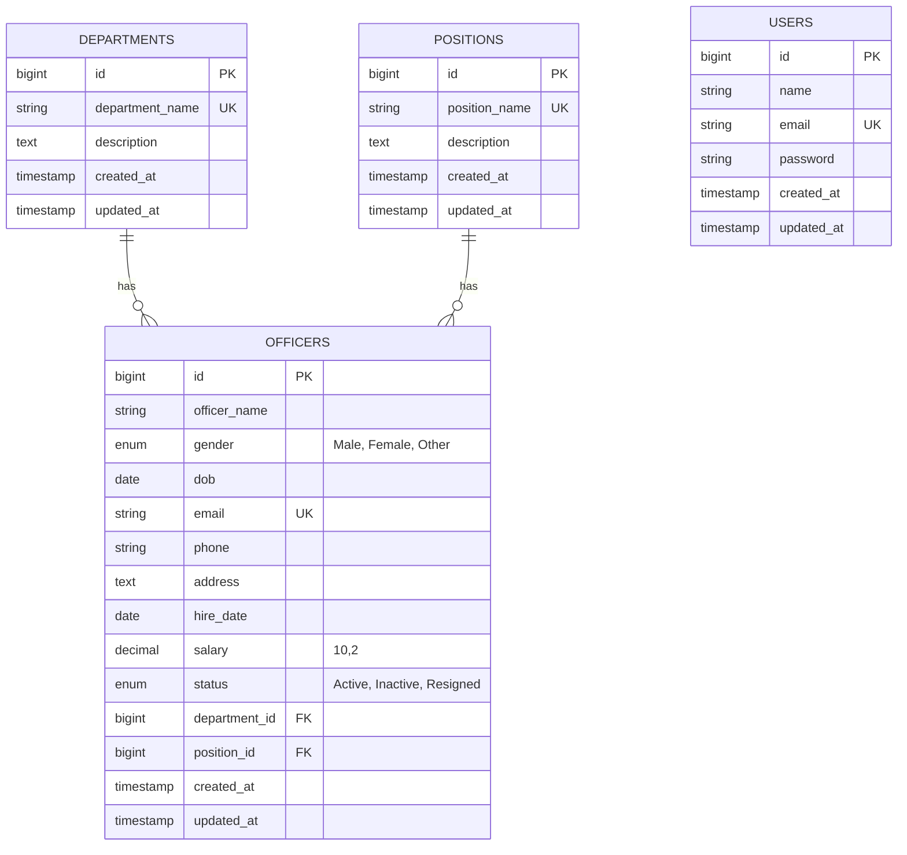

# Officer Management System (OMS)

A modern, robust, and full-featured **Officer Management System** designed for university final examination submissions and institutional personnel administration. Built following the Laravel MVC architectural pattern with Blade templates, Bootstrap 5, and MySQL relational database design.

---

## 1. Project Overview

The **Officer Management System** enables administrative personnel to securely manage, organize, and monitor departmental officers, official ranks/positions, and organizational units. It features a clean, responsive admin dashboard with live statistical cards, search and filtering, database relationships, and strict relational integrity protections.

---

## 2. Technology Stack

- **Backend Framework:** Laravel 13 (PHP 8.3+)
- **Architecture:** Model-View-Controller (MVC) with Form Request validation
- **Frontend / Templating:** Laravel Blade Templates
- **UI Framework:** Bootstrap 5.3 & Bootstrap Icons 1.11
- **Database:** MySQL 8.0+
- **ORM:** Laravel Eloquent with Eager Loading (preventing N+1 queries)
- **Authentication:** Laravel Session-based Authentication with Bcrypt hashing
- **Testing:** PHPUnit / Laravel Test Suite (41 automated feature & unit tests)
- **Code Style:** Laravel Pint

---

## 3. Key System Features

### Authentication & Access Control
- Session-based Login and Register with CSRF token protection.
- Secure password hashing (`bcrypt`).
- Guest / Auth middleware redirects (`guest` redirected to login, `auth` redirected to dashboard).
- *Academic Notice:* For this university project, newly registered accounts are automatically authorized as administrators.

### Department Management (CRUD)
- Create, view, edit, and delete departments.
- Search departments by name or description.
- Pagination with preserved query parameters.
- **Relational Integrity Protection:** Prevents deleting any department that currently has assigned officers.

### Position Management (CRUD)
- Create, view, edit, and delete job positions.
- Search positions by title or description.
- Unique validation on position titles.
- **Relational Integrity Protection:** Prevents deleting any position currently assigned to officers.

### Officer Management (Main Module)
- **Create Officer:** Comprehensive input form with Department and Position dropdowns, DOB, hire date, salary, and contact details.
- **Officer Directory:** Interactive data table displaying ID, Officer Name, Gender, Email, Phone, Department, Position, Status, and Actions.
- **Officer Profile (Details):** Detailed single-officer view displaying full personnel dossier and compensation details.
- **Edit & Update:** Edit officer records with preselected foreign key dropdowns and email uniqueness checking ignoring current record.
- **Delete Officer:** Safe deletion with Bootstrap 5 confirmation modal.
- **Multi-Field Search & Filter:**
  - Search by name, email, or phone.
  - Filter by Department.
  - Filter by Position.
  - Filter by Employment Status (`Active`, `Inactive`, `Resigned`).
  - Combined filter queries with Reset button.

### Administrative Dashboard
- **6 Real-time Database Metric Cards:** Total Officers, Active Officers, Inactive Officers, Resigned Officers, Total Departments, Total Positions.
- **Status Distribution Overview:** Visual progress meter breakdown of active vs. inactive vs. resigned staff.
- **Officers by Department:** Visual distribution chart showing officer concentration across departments.
- **Recent Officers Table:** Instant access to the latest registered officers.
- **Quick Action Bar:** Shortcuts for immediate officer or department creation.

---

## 4. Database Schema & Relationships

### Entity-Relationship Diagram



### Relational Mapping
- **Department** `hasMany(Officer::class)`
- **Position** `hasMany(Officer::class)`
- **Officer** `belongsTo(Department::class)` and `belongsTo(Position::class)`
- Foreign keys in MySQL enforce `ON DELETE RESTRICT` to ensure complete relational data integrity.

---

## 5. Installation & Setup Guide

### Prerequisites
- PHP >= 8.2 (PHP 8.3 recommended)
- Composer >= 2.0
- MySQL Server (e.g., Laragon, XAMPP, or standalone MySQL)
- Git

### Step 1: Clone the Repository
```bash
git clone https://github.com/your-username/officer-management.git
cd officer-management
```

### Step 2: Install Dependencies
```bash
composer install
```

### Step 3: Configure Environment
Copy the example environment file:
```bash
cp .env.example .env
```
Generate an application encryption key:
```bash
php artisan key:generate
```

Configure your MySQL credentials in `.env`:
```env
DB_CONNECTION=mysql
DB_HOST=127.0.0.1
DB_PORT=3306
DB_DATABASE=officer_management
DB_USERNAME=root
DB_PASSWORD=your_mysql_password
```

### Step 4: Run Database Migrations
Create the database tables:
```bash
php artisan migrate
```

### Step 5: Seed the Database
Populate realistic academic data (8 Departments, 12 Positions, 35 Officers with Cambodian sample names, 1 Admin account):
```bash
php artisan db:seed
```

Or refresh and re-seed in a single command:
```bash
php artisan migrate:fresh --seed
```

---

## 6. Default Development Credentials

For university evaluation and local testing:

| Role | Email | Password |
|---|---|---|
| **Administrator** | `admin@example.com` | `password123` |

Public registration is disabled. Only pre-configured and authorized administrative accounts can sign in to the portal.

---

## 7. Running the Application

Start the Laravel local development server:
```bash
php artisan serve
```
Then open your browser at:
```
http://127.0.0.1:8000
```

*(If using Laragon, you can access directly via `http://officer-management.test`)*

---

## 8. Automated Testing

The project includes 41 comprehensive automated tests covering authentication, route middleware, CRUD operations, unique constraints, search & filter combinations, relationship definitions, and foreign key deletion restrictions.

Execute the test suite:
```bash
php artisan test
```

Or run via PHPUnit directly:
```bash
vendor/bin/phpunit
```

All 41 tests pass with zero failures:
```
PASS  Tests\Feature\AuthenticationTest
PASS  Tests\Feature\DepartmentTest
PASS  Tests\Feature\ExampleTest
PASS  Tests\Feature\OfficerTest
PASS  Tests\Feature\PositionTest
PASS  Tests\Feature\RelationshipTest
PASS  Tests\Unit\ExampleTest

Tests:    41 passed (119 assertions)
Duration: 1.14s
```

---

## 9. Code Quality & Formatting

Format the code using Laravel Pint:
```bash
vendor/bin/pint
```

---

## 10. Project Directory Structure

```
app/
├── Http/
│   ├── Controllers/
│   │   ├── AuthController.php          # Login, Register, Logout
│   │   ├── DashboardController.php     # Statistics and summary metrics
│   │   ├── DepartmentController.php    # Department CRUD and restrictions
│   │   ├── PositionController.php      # Position CRUD and restrictions
│   │   └── OfficerController.php       # Officer CRUD, search & filters
│   └── Requests/
│       ├── StoreDepartmentRequest.php
│       ├── UpdateDepartmentRequest.php
│       ├── StorePositionRequest.php
│       ├── UpdatePositionRequest.php
│       ├── StoreOfficerRequest.php
│       └── UpdateOfficerRequest.php
└── Models/
    ├── User.php
    ├── Department.php
    ├── Position.php
    └── Officer.php

database/
├── factories/
│   ├── DepartmentFactory.php
│   ├── PositionFactory.php
│   └── OfficerFactory.php
├── migrations/
│   ├── 0001_01_01_000000_create_users_table.php
│   ├── 2026_10_10_154402_create_departments_table.php
│   ├── 2026_10_10_154407_create_positions_table.php
│   └── 2026_10_10_154408_create_officers_table.php
└── seeders/
    ├── DatabaseSeeder.php
    ├── DepartmentSeeder.php            # 8 Departments
    ├── PositionSeeder.php              # 12 Positions
    └── OfficerSeeder.php               # 35 Officers (Cambodian names)

resources/views/
├── auth/
│   ├── login.blade.php
│   └── register.blade.php
├── departments/
│   ├── index.blade.php
│   ├── create.blade.php
│   ├── edit.blade.php
│   └── _form.blade.php
├── positions/
│   ├── index.blade.php
│   ├── create.blade.php
│   ├── edit.blade.php
│   └── _form.blade.php
├── officers/
│   ├── index.blade.php
│   ├── create.blade.php
│   ├── edit.blade.php
│   ├── show.blade.php
│   └── _form.blade.php
├── layouts/
│   ├── app.blade.php                   # Master admin layout
│   └── guest.blade.php                 # Guest authentication layout
└── dashboard.blade.php

tests/Feature/
├── AuthenticationTest.php
├── DepartmentTest.php
├── PositionTest.php
├── OfficerTest.php
└── RelationshipTest.php
```

---

## 11. GitHub Submission Instructions

1. Ensure sensitive files like `.env`, `vendor/`, and temporary caches are not tracked (handled by `.gitignore`).
2. Initialize git and stage all files:
   ```bash
   git add .
   git commit -m "feat: complete Officer Management System for university examination"
   ```
3. Push to your GitHub repository:
   ```bash
   git branch -M main
   git remote add origin https://github.com/your-username/officer-management.git
   git push -u origin main
   ```

---

## 12. University Examination Notes

- **Simplicity & Code Clarity:** The codebase avoids over-engineered single-page applications (SPAs) and focuses strictly on pure Laravel MVC, standard Blade templates, and clean Eloquent queries so students can easily explain every route, controller method, and database relationship during examination defense.
- **Relational Integrity:** Foreign key constraints (`restrictOnDelete`) prevent accidental orphan records and mirror real-world administrative standards.
- **N+1 Prevention:** All list queries utilize eager loading (`with(['department', 'position'])`) for optimal database performance.
# Officer-MG

